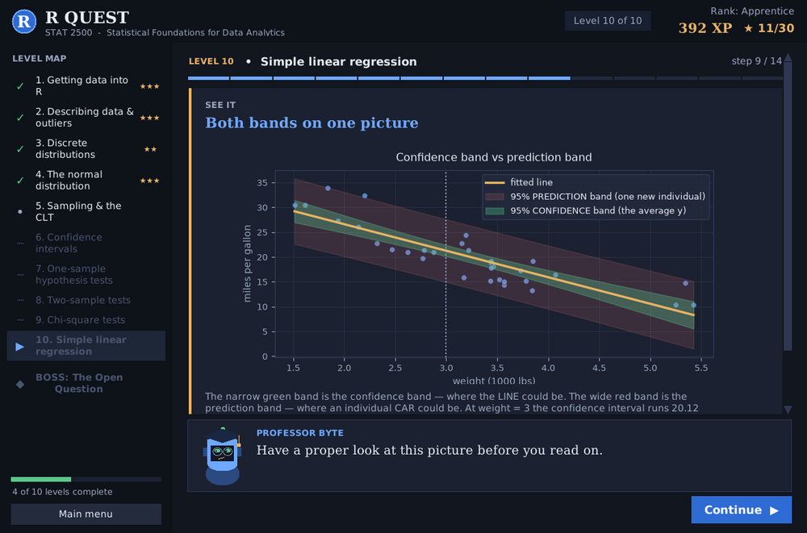
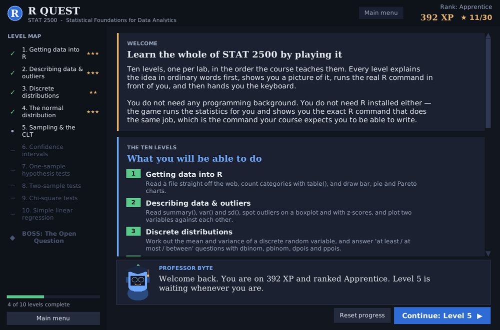
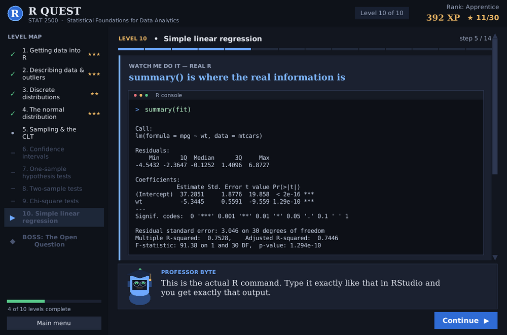
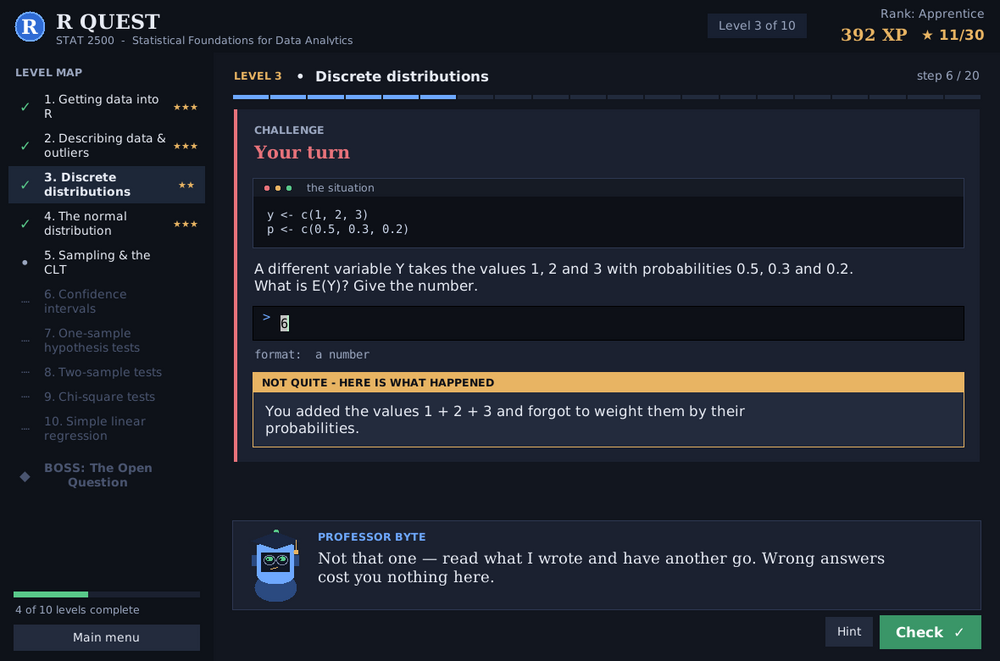
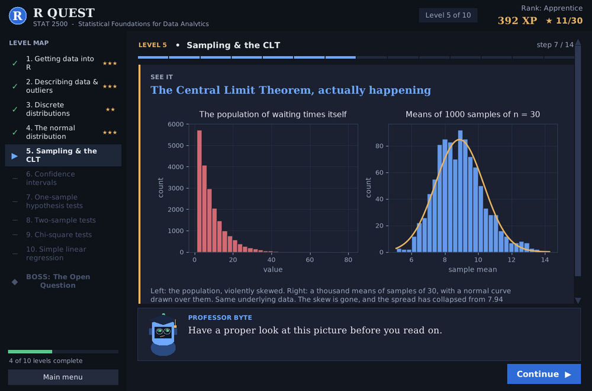

# R Quest — a STAT 2500 learning game

**A playable, self-contained university statistics course.** Ten levels, one per
lab, in the order the course teaches them, plus a boss challenge on a dataset
you have never seen.

It assumes **no programming background at all** — Level 1 starts by explaining
what a variable is — and takes most people **2–4 hours** end to end.

The engine runs in Python, but the course is taught in **R**, so every level
shows you the **exact R command** for what it just did and formats its output to
match the R console character for character. You come out able to write the R,
not just click through a game.



---

## ▶ Quick start

**1.** Install Python from [python.org](https://www.python.org/downloads/) if you
do not have it — **tick "Add python.exe to PATH"** on the installer's first
screen, then restart.

**2.** Download this repo (green **Code** button → **Download ZIP**) and
**extract** the zip.

**3.** Double-click:

| Your computer | Double-click this |
|---|---|
| Windows | **`Play-Windows.bat`** |
| macOS / Linux | **`play-mac-linux.command`** |

That is it. The first run spends a minute installing two packages, then the game
opens. **You do not need R installed.**

> **Windows shows "Windows protected your PC"?** Normal for any downloaded
> script. Click **More info → Run anyway**. To skip the warning, right-click the
> `.zip` → **Properties** → tick **Unblock** *before* extracting.

Prefer to type the commands yourself, or something went wrong?
**→ [INSTALL.md](INSTALL.md) walks through it three different ways, assuming
nothing.**

<details>
<summary>For people who already live in a terminal</summary>

```bash
pip install -r requirements.txt
python main.py
```

Dependencies are just `pandas` and `matplotlib` (numpy arrives with pandas).
Tested end to end on matplotlib 3.8 / pandas 2.2 / numpy 1.26 **and**
matplotlib 3.11 / pandas 3.1 / numpy 2.5, so a fresh `pip install` today and an
older environment both work. Tkinter ships with Python on Windows and macOS; on
Debian/Ubuntu it is `sudo apt install python3-tk`.
</details>

---

## Why this exists

Students in intro statistics are asked to learn two unrelated things at once:
what a confidence interval *means*, and how to type
`t.test(x, mu = 750)` without a syntax error. When the code throws an error,
people quietly conclude they are bad at statistics. They are not — they are
fighting two problems that got mashed into one.

R Quest separates them. Every idea is explained in ordinary language and shown
as a picture **before** any code appears. Then the code shows up as something to
read, not something to debug.

The part I care most about: **wrong answers get diagnosed, not scored.**

> You typed `1 - pbinom(5, 12, 0.25)` for "at least 5"
>
> *Close, but that subtracts everything up to **and including** 5, so you have
> thrown away the 5 you were supposed to keep. This gives P(X ≥ 6).*

That off-by-one is where marks actually get lost, and "incorrect" would never
have taught it.

---

---

## What it looks like

| | |
|---|---|
|  <br> **Ten levels, always visible.** Stars and XP track progress; finished levels stay replayable. |  <br> **Real R output.** Every number is checked against R itself — this pane matches `summary(lm(mpg ~ wt))` character for character. |
|  <br> **Wrong answers get diagnosed.** It works out the likely mistake and explains what your answer *would* have meant. |  <br> **Concepts get shown, not asserted.** The CLT is simulated live from a deliberately skewed population. |

---

## How to play

* **Continue** (or **Enter**) moves through an explanation, a picture or a worked
  example.
* When a **challenge** appears, type the R command and press **Check** (Enter also
  works). For the write-a-sentence challenges use **Ctrl+Enter**.
* A wrong answer costs you nothing. Professor Byte tells you **what your command
  would actually have done** — not just "incorrect" — and you try again.
* Stuck three times? A **Show me the answer** button appears and you keep going.
  Nothing can ever block your progress.
* **Hint** is always available on typed challenges.
* Click any unlocked level in the **map on the left** to replay it.
* **Esc** returns to the main menu. Progress is saved automatically to
  `~/.rquest_progress.json`.

XP and stars are there for motivation only. Stars reflect how many challenges you
got right first time; three stars means you nailed almost all of them.

---

## What it teaches

| Level | Topic | What you can do afterwards |
|---|---|---|
| 1 | Getting data into R | `c()`, `<-`, `read.table()` / `read.csv()` from a URL or a local file, `table()`, bar / pie / Pareto charts |
| 2 | Describing data & outliers | `summary()`, `var()`, `sd()`, `boxplot()` and the 1.5 IQR rule, z-scores, `plot(x, y)`, `sort()` / `rank()` |
| 3 | Discrete distributions | mean and variance of a discrete random variable, `dbinom` / `pbinom`, "at least / at most / between", `dpois` / `ppois` |
| 4 | The normal distribution | `pnorm`, `qnorm`, the **d/p/q/r** rule as one transferable idea, empirical rule, IQR/s, `qqnorm()` + `qqline()`, normal approximation with a continuity correction |
| 5 | Sampling & the CLT | population vs sample vs sampling distribution, simulating means with a `for` loop, `sigma/sqrt(n)`, the Central Limit Theorem seen and QQ-checked |
| 6 | Confidence intervals | large-sample z interval, `t.test(x)$conf.int`, `prop.test()`, and why a 90% interval is narrower than a 95% one |
| 7 | One-sample hypothesis tests | H0 vs Ha in plain words, z-test, `t.test(x, mu = )`, `prop.test(x, n, p = )`, p-value against alpha, and writing the conclusion as an English sentence |
| 8 | Two-sample tests | independent z, pooled vs **Welch** t (`var.equal`), **paired** t, two-proportion test, and a decision tree for choosing between them |
| 9 | Chi-square tests | observed vs expected, goodness of fit, test of independence, degrees of freedom and critical values |
| 10 | Simple linear regression | `lm()`, reading `summary()`, `confint()`, and `predict()` — **CONFIDENCE vs PREDICTION intervals**, taught explicitly |
| ◆ | **Boss challenge** | An unseen dataset and one open question. Seven unscripted stages: load, describe, visualise, choose a test, run it, read it, conclude in plain English. |

Every level follows the same loop: **plain-language explanation → a real picture
of the concept → the exact R command and its output → your turn → diagnostic
feedback and retry → a recap of the 3–5 things to remember.**

---

## Datasets

The game tries the **live public URL** first, with a short timeout, and silently
falls back to the bundled copy in `data/` if there is no internet. Either way it
shows you the real `read.table()` / `read.csv()` URL command, and it tells you on
screen when the offline copy is in use.

| Key | File | Source |
|---|---|---|
| `chol` | `data/chol.txt` | `https://assets.datacamp.com/blog_assets/chol.txt` — the dataset the STAT 2500 labs use |
| `mtcars` | `data/mtcars.csv` | R's built-in `mtcars`, via the Rdatasets mirror |
| `sleep` | `data/sleep.csv` | R's built-in `sleep` — the textbook paired-samples example |
| `tooth` | `data/ToothGrowth.csv` | R's built-in `ToothGrowth` |
| `iris` | `data/iris.csv` | R's built-in `iris` — **held back from all ten levels** so the boss challenge really is on unseen data |

> **One honest note about the offline copy of `chol.txt`.** `mtcars`, `sleep`,
> `ToothGrowth` and `iris` are bundled as the genuine articles and reproduce R's
> published values exactly. The bundled `chol.txt` is a **simulated stand-in**
> with the same seven columns and realistic distributions, because the original
> could not be redistributed with the game. When you have internet, the game
> downloads the real file and everything you see comes from that. Offline, the
> teaching is identical but the specific numbers differ.

---

## Project layout

```
rquest/
├── Play-Windows.bat         double-click launcher for Windows
├── play-mac-linux.command   double-click launcher for macOS / Linux
├── main.py                  entry point + a map of the ten levels for editors
├── requirements.txt         pandas, matplotlib
├── README.md
├── INSTALL.md               beginner install guide, three routes, no assumptions
├── CONTRIBUTING.md          how to add a level or a wrong-answer diagnosis
├── LICENSE                  MIT
├── data/                    bundled offline copies of every dataset
│   └── chol.txt  mtcars.csv  sleep.csv  ToothGrowth.csv  iris.csv
├── docs/                    screenshots used by this README
├── rquest/
│   ├── app.py               the window, the level map, the step runner
│   ├── ui.py                reusable widgets: cards, buttons, R console pane, the NPC
│   ├── theme.py             all colours and fonts, in one place
│   ├── steps.py             the seven step types a level is built from
│   ├── grading.py           answer checking + the misconception diagnoses
│   ├── progress.py          XP, stars, unlocks, save file
│   ├── datasets.py          URL-first loading with the offline fallback
│   ├── rstats.py            statistics printed exactly as the R console prints them
│   ├── distributions.py     normal / t / chi-square / F / binomial / Poisson, pure Python
│   ├── plots.py             every matplotlib figure the levels use
│   └── levels/
│       ├── __init__.py      the registry: titles and goals
│       ├── _common.py       shared helpers and reusable wrong-answer diagnoses
│       ├── level01.py … level10.py     pure content, no Tkinter anywhere
│       └── boss.py          the boss challenge and its report card
└── tools/
    ├── verify.py            headless walk-through of every level and the boss
    ├── verify_stats.py      every printed statistic, checked against real R
    ├── playthrough.py       drives the real widgets and plays the whole game
    ├── screens.py           captures the key screens
    └── sizes.py             checks the layout at common laptop sizes
```

### Adding a level

Write `rquest/levels/level11.py` with a `build()` that returns a `Level` holding a
list of steps (see `steps.py` for the seven types), then add its title and goal to
`rquest/levels/__init__.py`. Level files never import Tkinter — the engine knows
how to draw each step type.

### Checking your changes

```bash
python tools/verify.py          # every level: plots render, model answers accepted
python tools/playthrough.py     # plays the whole game through the real widgets
```

`verify.py` runs headless. `playthrough.py` needs a display; on a headless Linux
box run it as `xvfb-run -a python tools/playthrough.py`.

---

## Why the numbers can be trusted

`rquest/distributions.py` implements the normal, t, chi-square, F, binomial and
Poisson distributions in pure Python (Wichura's AS 241 for `qnorm`, continued
fractions for the incomplete beta and gamma functions) so that the game needs no
SciPy. Every result is checked against known R output — `summary(mtcars$mpg)`,
`t.test(len ~ supp, data = ToothGrowth)`, `t.test(extra ~ group, data = sleep,
paired = TRUE)`, `summary(lm(mpg ~ wt, mtcars))`, `confint()`, `predict()` with
both interval types — and matches R to seven significant figures, including R's
own number-formatting conventions.

## Known limitations

* The bundled `chol.txt` is a simulated stand-in (see the note above). Everything
  else is the genuine dataset.
* The game runs the statistics itself and shows you the R command; it does not
  execute R. There is no R interpreter to install, but equally you cannot type an
  arbitrary R expression and have it evaluated — challenges check the command you
  write against the expected form.
* Typed challenges forgive capitalisation, spacing, quote style and `=` vs `<-`,
  but they cannot accept every valid way of writing a command. If you are sure
  your answer is right and it is rejected, the **Show me the answer** button
  appears after three tries and you lose nothing but the XP.
* The plain-English conclusion challenges are graded on keywords, generously.
  They check that the decision, the level, the quantity and the direction are all
  present — they cannot judge elegance.
* Window minimum is 940×660. Below roughly 700 pixels of height, long captions
  need a short scroll.

---

## Licence

MIT — see [LICENSE](LICENSE). Use it, fork it, hand it to your students.
